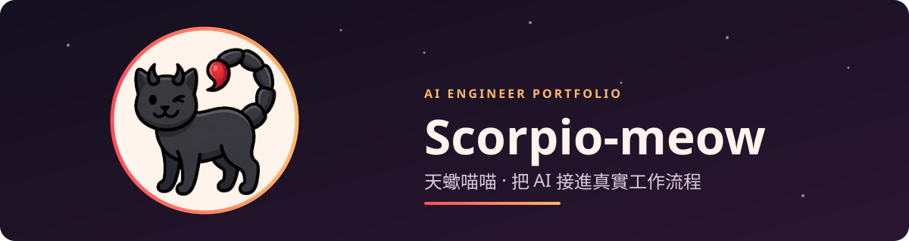
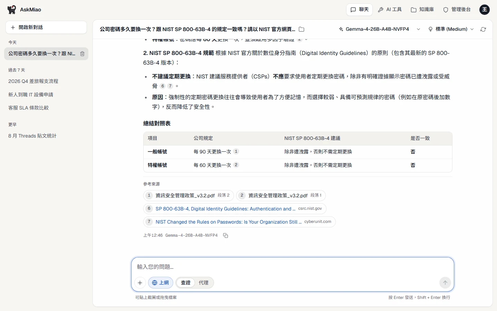
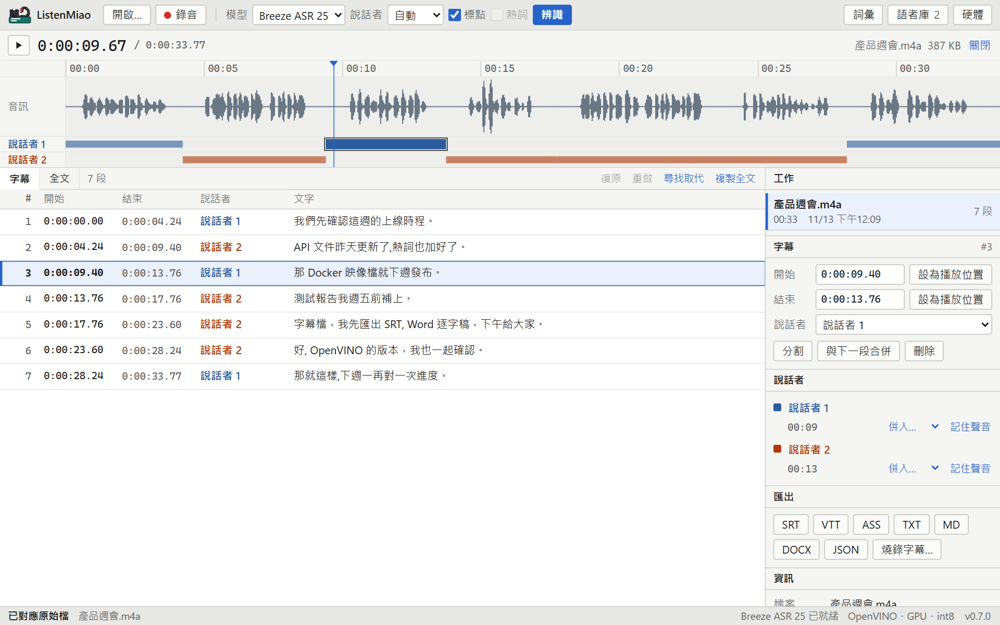
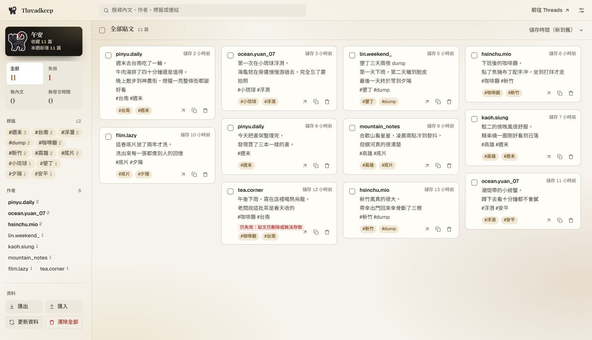
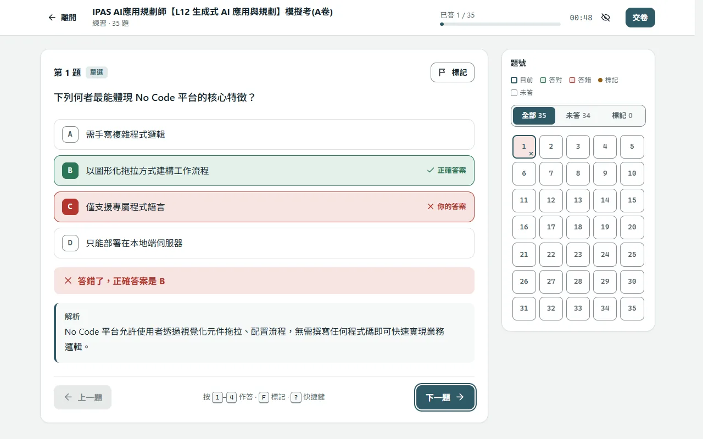
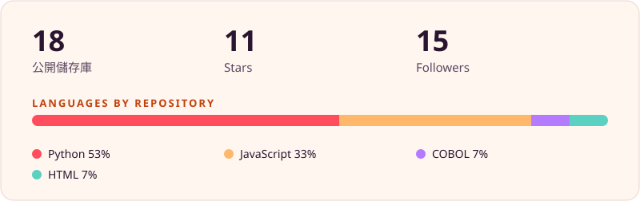

<picture>
  <source media="(prefers-color-scheme: dark)" srcset="assets/hero.svg">
  <source media="(prefers-color-scheme: light)" srcset="assets/hero-light.svg">
  
</picture>

**自架、可引用、能接進工作流程的 AI 工具：文件檢索、語音轉錄、叫號系統與 Agent Skill。**

[AskMiao](https://scorpio-meow.github.io/AskMiao/) · [ListenMiao](https://scorpio-meow.github.io/ListenMiao/) · [Threadkeep](https://scorpio-meow.github.io/Threadkeep/) · [DrillMiao](https://scorpio-meow.github.io/DrillMiao/) · [所有儲存庫](https://github.com/Scorpio-meow?tab=repositories)

<h2></h2>

<table>
  <tr>
    <td width="50%" valign="top">
      
       <b>AskMiao</b>：自架 RAG 聊天機器人，研究公司文件並標註每項論述出處。
       FAISS 加 BM25 混合檢索；ReAct Agent 可建立與編輯 Word、Excel、PowerPoint、PDF；MCP 與 OpenAPI 工具需使用者核准。
       <a href="https://github.com/Scorpio-meow/AskMiao">原始碼</a> · <a href="https://scorpio-meow.github.io/AskMiao/">網站</a>
    </td>
    <td width="50%" valign="top">
      
       <b>ListenMiao</b>：本機網頁應用，以 Breeze ASR 把音訊轉成字幕與逐字稿，不上傳音訊。
       台灣華語、中英夾雜與台語；講者分離、字幕編輯、SRT 與 DOCX 匯出、CLI、MCP server。
       <a href="https://github.com/Scorpio-meow/ListenMiao">原始碼</a> · <a href="https://scorpio-meow.github.io/ListenMiao/">網站</a>
    </td>
  </tr>
  <tr>
    <td width="50%" valign="top">
      
       <b>Threadkeep</b>：Manifest V3 瀏覽器擴充功能，一鍵保存 Threads 貼文的官方嵌入碼。
       資料留在瀏覽器；瀑布流儀表板、標籤雲、即時預覽、.js 匯出。
       <a href="https://github.com/Scorpio-meow/Threadkeep">原始碼</a> · <a href="https://scorpio-meow.github.io/Threadkeep/">網站</a>
    </td>
    <td width="50%" valign="top">
      
       <b>DrillMiao</b>：純前端模擬測驗與練習工具。
       內建 11 個題庫；錯題重練、進度自動儲存、成績趨勢、CSV 與 JSON 匯出。
       <a href="https://github.com/Scorpio-meow/DrillMiao">原始碼</a> · <a href="https://scorpio-meow.github.io/DrillMiao/">網站</a>
    </td>
  </tr>
</table>

**CallMiao**：可嵌入任何網站的叫號系統。取號機、櫃檯後台、大廳顯示與語音叫號、手機追蹤、管理介面，全由單一伺服器提供（Bun 或 Node.js、Socket.IO、SQLite）。[原始碼](https://github.com/Scorpio-meow/CallMiao)

<h2></h2>

- **文件與知識檢索**：AskMiao 把公司文件變成可查詢、每句話都附出處的知識來源。
- **語音與資料不出本機**：ListenMiao 在本機完成轉錄，適合不能上傳音訊的場景。
- **Agent 與工具整合**：把外部 API 與文件整理成 Agent 能穩定使用的 Skill 與 MCP 工具。
- **現場流程自動化**：CallMiao 把取號、叫號與顯示整合在單一自架服務。

<h2></h2>

- **自架與本機優先**：ListenMiao 不上傳音訊，Threadkeep 的資料留在瀏覽器，AskMiao 可接 Ollama 或 vLLM 在自己的環境推論。
- **每項論述附出處**：AskMiao 回答時以 [n] 對回原文段落，查不到就照實說。
- **先試跑再執行**：LINE-skill 的 Messaging API 腳本預設先 dry-run。
- **外部動作需核准**：AskMiao 的 MCP 與 OpenAPI 工具在呼叫前須經使用者同意。
- **少依賴、可離線**：DrillMiao 與 Liquid-Cipher 以零依賴的原生網頁實作，進度自動儲存或可離線遊玩。
- **驗證而非假設**：Liquid-Cipher 的每一關都由 BFS 解題器驗證可解。

<h2></h2>

| Skill | 用途 | 連結 |
| --- | --- | --- |
| **LINE-skill** | 協助 AI 編程助手開發 LINE Bot、LIFF 與 LINE Login，含即時官方文件查詢與先試跑的 Messaging API 腳本 | [原始碼](https://github.com/Scorpio-meow/LINE-skill) |
| **Threads-skill** | 協助 AI 編程助手撰寫與除錯 Meta Threads API 整合，或以自己的權杖發文與取得洞察 | [原始碼](https://github.com/Scorpio-meow/Threads-skill) · [網站](https://scorpio-meow.github.io/Threads-skill/) |
| **senior-network-engineer-skill-bundle** | 資深網路工程師技能包：跨廠牌主技能加 Palo Alto、Fortinet、Cisco、HPE Aruba 子技能 | [原始碼](https://github.com/Scorpio-meow/senior-network-engineer-skill-bundle) |
| **Threads-API** | Meta Threads API 文件的非官方 Markdown 鏡像（49 頁），方便搜尋、引用與 RAG | [原始碼](https://github.com/Scorpio-meow/Threads-API) |

<h2></h2>

<!--RECENT:START-->
| 更新日 | 專案 | 說明 |
| --- | --- | --- |
| 2026-11-16 | [CallMiao](https://github.com/Scorpio-meow/CallMiao) | Embeddable queue ticketing and calling system for any website: kiosk, agent dashboard... |
| 2026-11-15 | [AskMiao](https://github.com/Scorpio-meow/AskMiao) | Self-hosted RAG chatbot that researches company documents and cites every claim. Hybrid... |
| 2026-11-15 | [ListenMiao](https://github.com/Scorpio-meow/ListenMiao) | ListenMiao: local web app for MediaTek Research's Breeze ASR 25/26. Turn Taiwanese... |
| 2026-11-14 | [DrillMiao](https://github.com/Scorpio-meow/DrillMiao) | Zero-dependency, client-side mock exam and practice app with 11 built-in question banks... |
| 2026-11-14 | [Threads-skill](https://github.com/Scorpio-meow/Threads-skill) | Agent Skill that teaches AI coding assistants the Meta Threads API: write, review and... |
<!--RECENT:END-->

<h2></h2>

<h2></h2>

- **AI 系統**：RAG、混合檢索（FAISS、BM25）、ReAct Agent、Agent Skills、MCP、語音辨識；模型支援 OpenAI、Claude、Gemini、Ollama、vLLM
- **應用整合**：LINE Messaging API、LIFF、Threads API、Manifest V3 擴充功能、GitHub Pages
- **後端與前端**：Python、FastAPI、Bun、Node.js、Express、Socket.IO、SQLite、原生 JavaScript
- **基礎設施**：自架部署、Docker、本機推論（CPU、Intel GPU、NVIDIA、AMD）

<h2></h2>

- [Miao-Playground](https://github.com/Scorpio-meow/Miao-Playground)：五個小遊戲與互動工具的集合
- [Liquid-Cipher](https://github.com/Scorpio-meow/Liquid-Cipher)：無盡倒水排序 PWA，每一關都由 BFS 解題器驗證可解（[試玩](https://scorpio-meow.github.io/Liquid-Cipher/)）
- [Stardust-Labyrinth](https://github.com/Scorpio-meow/Stardust-Labyrinth)：終端機迷宮遊戲，幽靈以曼哈頓距離追捕
- [Quantum-Duel](https://github.com/Scorpio-meow/Quantum-Duel)：回合制終端機對戰，AI 依戰況調整出招權重
- [Azure-OpenAI-VS-Code-Proxy](https://github.com/Scorpio-meow/Azure-OpenAI-VS-Code-Proxy)：修正 VS Code 與 Azure OpenAI 溫度參數相容問題的本機 FastAPI 代理
- [COBOL-Introductory-Examples](https://github.com/Scorpio-meow/COBOL-Introductory-Examples)：COBOL 銀行系統範例

<h2></h2>

歡迎在各專案的 Issues 提出問題與建議：[AskMiao](https://github.com/Scorpio-meow/AskMiao/issues) · [ListenMiao](https://github.com/Scorpio-meow/ListenMiao/issues) · [Threadkeep](https://github.com/Scorpio-meow/Threadkeep/issues) · [CallMiao](https://github.com/Scorpio-meow/CallMiao/issues)

追蹤與合作：[github.com/Scorpio-meow](https://github.com/Scorpio-meow)

Email：[yao921024@gmail.com](mailto:yao921024@gmail.com)

